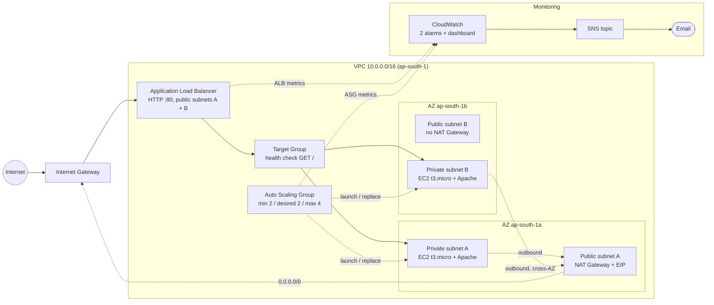
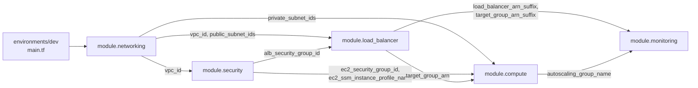

# Modular AWS Infrastructure Using Terraform

> **Portfolio Project 01** of a 10-project DevOps and Cloud Engineering series.

A hands-on AWS infrastructure project built with Terraform. It deploys a two-tier web environment in the AWS Mumbai region (`ap-south-1`): a custom VPC with public and private subnets across two Availability Zones, an internet-facing Application Load Balancer, private EC2 instances managed by an Auto Scaling Group, and CloudWatch monitoring with SNS email alerting.

The infrastructure was first written as a flat Terraform configuration, deployed to AWS, and then refactored into five reusable modules using Terraform `moved` blocks, without destroying or recreating the deployed resources.


---

## Table of Contents

1. [Project Objectives](#1-project-objectives)
2. [Problem Statement](#2-problem-statement)
3. [Key Features](#3-key-features)
4. [Architecture Diagram](#4-architecture-diagram)
5. [Architecture Explanation](#5-architecture-explanation)
6. [AWS Services Used](#6-aws-services-used)
7. [Terraform Module Architecture](#7-terraform-module-architecture)
8. [Repository Structure](#8-repository-structure)
9. [Module Details](#9-module-details)
10. [Purpose of `moved.tf`](#10-purpose-of-movedtf)
11. [Prerequisites](#11-prerequisites)
12. [AWS Authentication Setup](#12-aws-authentication-setup)
13. [Deployment Instructions](#13-deployment-instructions)
14. [Verification](#14-verification)
15. [CloudWatch Dashboard and Alarms](#15-cloudwatch-dashboard-and-alarms)
16. [SNS Notification Workflow](#16-sns-notification-workflow)
17. [Failure Simulations](#17-failure-simulations)
18. [Security Considerations](#18-security-considerations)
19. [Cost Considerations](#19-cost-considerations)
20. [Cleanup](#20-cleanup)
21. [Project Learnings](#21-project-learnings)
22. [Known Limitations](#22-known-limitations)
23. [Future Improvements](#23-future-improvements)
24. [License](#24-license)

Additional documentation:

- [docs/implementation.md](docs/implementation.md): build stages, resource inventory and module wiring
- [docs/troubleshooting.md](docs/troubleshooting.md): failure simulations and common issues
- [docs/cost-and-security.md](docs/cost-and-security.md): cost drivers and security review

---

## 1. Project Objectives

- Build a custom AWS network with public and private subnets across two Availability Zones.
- Run application servers in private subnets, reachable only through an Application Load Balancer.
- Use an Auto Scaling Group to keep a fixed number of healthy EC2 instances running.
- Administer instances through AWS Systems Manager Session Manager instead of SSH.
- Monitor load balancer and Auto Scaling metrics with CloudWatch, and send alerts by email through SNS.
- Refactor a working flat Terraform configuration into reusable modules without recreating infrastructure.
- Test failure scenarios and document how each AWS mechanism responds.

## 2. Problem Statement

Running a web application on a single, publicly exposed EC2 instance creates several problems:

- The server is directly reachable from the internet.
- One instance or application failure takes the application offline.
- Failed instances must be found and replaced by hand.
- Nobody is notified when something goes wrong.
- Infrastructure built by hand in the console is hard to reproduce or review.

This project addresses these problems with private application subnets, a load balancer with health checks, an Auto Scaling Group that replaces failed instances, CloudWatch alarms with SNS notifications, and the whole environment defined as modular Terraform code.

## 3. Key Features

| Area | Implementation |
|---|---|
| Networking | Custom VPC `10.0.0.0/16`, 2 public and 2 private subnets in `ap-south-1a` and `ap-south-1b` |
| Internet access | Internet Gateway for public subnets; a single NAT Gateway for private subnet outbound traffic |
| Load balancing | Internet-facing Application Load Balancer with an HTTP listener on port 80 |
| Compute | Launch Template (Amazon Linux 2023, `t3.micro`, Apache via user data) and an Auto Scaling Group (min 2, desired 2, max 4) |
| Health checks | ALB target health checks on `/`; Auto Scaling uses `ELB` health checks to replace unhealthy instances |
| Access | IAM role with `AmazonSSMManagedInstanceCore` for Session Manager access; no SSH rule in security groups |
| Monitoring | 2 CloudWatch alarms and a 4-widget CloudWatch dashboard |
| Alerting | SNS topic with an email subscription for alarm and OK notifications |
| Code structure | 5 Terraform modules called from a `dev` environment |
| Refactoring | `moved.tf` with 32 `moved` blocks (31 resources + 1 data source) that migrated the flat configuration into modules |

## 4. Architecture Diagram

The editable source is in [`architecture/architecture.mmd`](architecture/architecture.mmd).



## 5. Architecture Explanation

**Inbound traffic.** A user request reaches the VPC through the Internet Gateway. The internet-facing ALB, which has nodes in both public subnets, receives it on port 80. The HTTP listener forwards the request to the target group, and the target group sends it only to targets that pass health checks. The targets are EC2 instances in the two private subnets.

**Outbound traffic.** The private instances have no public IP addresses. Their outbound traffic, such as package installation during boot, follows the private route table's `0.0.0.0/0` route to the NAT Gateway. The NAT Gateway sends it through the Internet Gateway. There is **one** NAT Gateway, in public subnet A (`ap-south-1a`). Both private subnets share one private route table, so traffic from private subnet B crosses Availability Zones to reach it.

**Instance management.** The Auto Scaling Group launches instances from the Launch Template across both private subnets and registers them with the target group. It keeps the in-service count at the desired capacity of 2. It replaces instances that are terminated or that fail the ELB health check.

**Monitoring.** CloudWatch collects ALB, target group and Auto Scaling Group metrics. Two alarms send notifications to an SNS topic, which delivers them by email. A dashboard shows the main metrics in one view.

## 6. AWS Services Used

| AWS Service | Purpose in this project |
|---|---|
| Amazon VPC | Isolated network with CIDR `10.0.0.0/16` |
| Subnets | 2 public subnets (ALB, NAT Gateway) and 2 private subnets (EC2) |
| Internet Gateway | Internet access for public subnets |
| NAT Gateway + Elastic IP | Outbound-only internet access for private subnets |
| Route tables | One public route table (to the IGW) and one private route table (to the NAT Gateway) |
| Security groups | ALB allows HTTP/HTTPS from the internet; EC2 allows HTTP only from the ALB security group |
| Application Load Balancer | Receives HTTP traffic and forwards it to healthy targets |
| EC2 + Launch Template | Amazon Linux 2023 `t3.micro` instances running Apache |
| EC2 Auto Scaling | Maintains capacity and replaces unhealthy instances |
| IAM | EC2 role and instance profile with `AmazonSSMManagedInstanceCore` |
| AWS Systems Manager | Session Manager shell access to private instances without SSH |
| Amazon CloudWatch | Metrics, 2 alarms and a dashboard |
| Amazon SNS | Email delivery of alarm notifications |

## 7. Terraform Module Architecture

The `dev` environment calls five local modules and passes outputs from one module into the next:



| Module call | Source path | Managed resources |
|---|---|---|
| `module.networking` | `modules/networking` | 16 |
| `module.security` | `modules/security` | 5 |
| `module.load_balancer` | `modules/load-balancer` | 3 |
| `module.compute` | `modules/compute` | 2 resources + 1 data source |
| `module.monitoring` | `modules/monitoring` | 5 |
| **Total** | | **31 resources + 1 data source** |

> The module call is named `load_balancer` (underscore) because Terraform identifiers cannot contain hyphens. The directory is named `load-balancer`.

## 8. Repository Structure

```text
production-grade-aws-infrastructure-terraform/
├── README.md
├── .gitignore
├── LICENSE                         # MIT License
├── architecture/
│   └── architecture.mmd            # Editable Mermaid architecture diagram
├── docs/
│   ├── implementation.md           # Build stages, resource inventory, module wiring
│   ├── troubleshooting.md          # Failure simulations and common issues
│   └── cost-and-security.md        # Cost drivers and security review
├── environments/
│   └── dev/
│       ├── main.tf                 # Calls the five modules
│       ├── provider.tf             # AWS provider (~> 6.0), region ap-south-1
│       ├── variables.tf            # Environment input variables
│       ├── outputs.tf              # Root outputs (VPC, subnets, target group, ASG, SNS, dashboard)
│       ├── moved.tf                # 32 flat-to-module migration blocks
│       ├── terraform.tfvars.example
│       └── .terraform.lock.hcl     # Provider version lock (hashicorp/aws 6.72.0)
├── modules/
│   ├── networking/                 # VPC, subnets, IGW, NAT, routes
│   ├── security/                   # Security groups, IAM role, instance profile
│   ├── load-balancer/              # ALB, target group, listener
│   ├── compute/                    # AMI lookup, Launch Template, ASG
│   └── monitoring/                 # SNS, CloudWatch alarms, dashboard
└── screenshots/
    └── README.md                   # List of evidence screenshots to add
```

Each module directory contains `main.tf`, `variables.tf` and `outputs.tf`.

Files that exist locally but are **intentionally not committed**: `terraform.tfstate`, `terraform.tfstate.backup`, `terraform.tfvars`, `terraform-state-before-modules.json`, `main.tf.stage6-backup` and the `.terraform/` directory. See [Security Considerations](#18-security-considerations).

## 9. Module Details

### 9.1 Networking (`modules/networking`)

| Resource | Terraform address | Details |
|---|---|---|
| VPC | `aws_vpc.main` | `10.0.0.0/16`, DNS support and DNS hostnames enabled |
| Public subnet A | `aws_subnet.public_a` | `10.0.1.0/24`, `ap-south-1a`, public IP on launch |
| Public subnet B | `aws_subnet.public_b` | `10.0.3.0/24`, `ap-south-1b`, public IP on launch |
| Private subnet A | `aws_subnet.private_a` | `10.0.2.0/24`, `ap-south-1a` |
| Private subnet B | `aws_subnet.private_b` | `10.0.4.0/24`, `ap-south-1b` |
| Internet Gateway | `aws_internet_gateway.main` | Attached to the VPC |
| Public route table | `aws_route_table.public` + `aws_route.public_internet` | `0.0.0.0/0` to the Internet Gateway |
| Private route table | `aws_route_table.private` + `aws_route.private_nat` | `0.0.0.0/0` to the NAT Gateway |
| Route table associations | `aws_route_table_association.public_a/b`, `private_a/b` | 4 associations |
| Elastic IP | `aws_eip.nat` | VPC domain, used by the NAT Gateway |
| NAT Gateway | `aws_nat_gateway.main` | Single NAT Gateway in public subnet A |

Inputs: `vpc_cidr`, `project_name`, `environment`. Outputs: `vpc_id`, `public_subnet_ids`, `private_subnet_ids`, and individual subnet IDs.

### 9.2 Security (`modules/security`)

| Resource | Terraform address | Details |
|---|---|---|
| ALB security group | `aws_security_group.alb` | `dev-alb-sg`; ingress TCP 80 and 443 from `0.0.0.0/0`; all egress |
| EC2 security group | `aws_security_group.ec2` | `dev-ec2-sg`; ingress TCP 80 **only from the ALB security group**; all egress |
| IAM role | `aws_iam_role.ec2_ssm_role` | `dev-ec2-ssm-role`, trusted by `ec2.amazonaws.com` |
| Policy attachment | `aws_iam_role_policy_attachment.ssm_core` | AWS managed `AmazonSSMManagedInstanceCore` |
| Instance profile | `aws_iam_instance_profile.ec2_ssm_profile` | `dev-ec2-ssm-profile` |

There is no SSH (port 22) rule. Instances are administered through Session Manager.

### 9.3 Load Balancer (`modules/load-balancer`)

| Resource | Terraform address | Details |
|---|---|---|
| Application Load Balancer | `aws_lb.main` | `dev-application-alb`, internet-facing, in both public subnets |
| Target group | `aws_lb_target_group.app` | `dev-app-target-group`, HTTP 80 |
| HTTP listener | `aws_lb_listener.http` | Port 80, forwards to the target group |

Target group health check: path `/`, protocol HTTP, matcher `200`, interval 30 seconds, healthy threshold 2, unhealthy threshold 2.

### 9.4 Compute (`modules/compute`)

| Resource | Terraform address | Details |
|---|---|---|
| AMI lookup | `data.aws_ami.amazon_linux` | Latest Amazon-owned `al2023-ami-2023.*-kernel-*-x86_64` HVM image |
| Launch Template | `aws_launch_template.app` | Prefix `dev-app-server-`, `t3.micro`, SSM instance profile, EC2 security group, user data |
| Auto Scaling Group | `aws_autoscaling_group.app` | `dev-app-asg`, min 2 / desired 2 / max 4, private subnets, attached to the target group |

ASG settings: `health_check_type = "ELB"`, `health_check_grace_period = 180` seconds, Launch Template version `$Latest`, and 1-minute group metrics enabled (min, max, desired, in-service, pending, total).

User data installs and starts Apache and writes the test page:

```bash
dnf install -y httpd
systemctl enable httpd
systemctl start httpd
echo "<h1>Application Server - Project 01</h1>" > /var/www/html/index.html
```

### 9.5 Monitoring (`modules/monitoring`)

| Resource | Terraform address | Details |
|---|---|---|
| SNS topic | `aws_sns_topic.alerts` | `dev-infrastructure-alerts` |
| Email subscription | `aws_sns_topic_subscription.email_alerts` | Endpoint from `var.alert_email`; must be confirmed by email |
| Unhealthy target alarm | `aws_cloudwatch_metric_alarm.unhealthy_targets` | `dev-alb-unhealthy-targets` |
| ASG capacity alarm | `aws_cloudwatch_metric_alarm.asg_capacity` | `dev-asg-low-capacity` |
| Dashboard | `aws_cloudwatch_dashboard.main` | `<project_name>-<environment>-dashboard` |

Alarm and dashboard details are in [Section 15](#15-cloudwatch-dashboard-and-alarms).

## 10. Purpose of `moved.tf`

This project started as a single flat configuration in `environments/dev/main.tf`. All resources had root-level addresses such as `aws_vpc.main`, and the configuration was applied to AWS. The code was then split into five modules, which changes every resource address. For example, `aws_vpc.main` becomes `module.networking.aws_vpc.main`.

Without guidance, Terraform treats an address change as "destroy the old resource, create a new one". `environments/dev/moved.tf` contains **32 `moved` blocks**: one for each of the 31 managed resources and one for the AMI data source. They tell Terraform that the existing objects in state now live at new addresses:

```hcl
moved {
  from = aws_vpc.main
  to   = module.networking.aws_vpc.main
}
```

| Target module | `moved` blocks |
|---|---|
| `module.networking` | 16 |
| `module.security` | 5 |
| `module.load_balancer` | 3 |
| `module.compute` | 3 (including `data.aws_ami.amazon_linux`) |
| `module.monitoring` | 5 |

After the refactor, `terraform plan` reported `Plan: 0 to add, 0 to change, 0 to destroy.`, which confirmed that the deployed infrastructure was unchanged.

**Why the file is kept:** the blocks document the refactoring history in code. They also let any state file that still uses the old flat addresses migrate safely. Against the current state they are no-ops, so keeping them is harmless. They should only be removed on purpose, once no older copies of the state need migrating.

## 11. Prerequisites

| Tool | Notes |
|---|---|
| AWS account | IAM permissions for VPC, EC2, ELB, Auto Scaling, IAM, CloudWatch, SNS and SSM |
| [Terraform](https://developer.hashicorp.com/terraform/install) | A version that supports `moved` blocks (1.1+); the AWS provider is constrained to `~> 6.0` |
| [AWS CLI v2](https://docs.aws.amazon.com/cli/latest/userguide/getting-started-install.html) | For authentication and verification commands |
| [Session Manager plugin](https://docs.aws.amazon.com/systems-manager/latest/userguide/session-manager-working-with-install-plugin.html) | Optional; needed for `aws ssm start-session` from the CLI |
| Email address | Receives SNS alert emails |

## 12. AWS Authentication Setup

Terraform uses the standard AWS credential chain. Configure a named profile with the AWS CLI:

```powershell
aws configure --profile terraform-lab
# AWS Access Key ID, Secret Access Key, default region: ap-south-1, output: json

$env:AWS_PROFILE = "terraform-lab"     # PowerShell
# export AWS_PROFILE=terraform-lab     # Linux / macOS

aws sts get-caller-identity             # confirm which account and identity are in use
```

Never put access keys in `.tf` or `.tfvars` files. Use a least-privilege IAM user or IAM Identity Center (SSO) credentials rather than the root account.

## 13. Deployment Instructions

All commands run from the `environments/dev` directory.

### 13.1 Configure variables

```powershell
cd environments/dev
Copy-Item terraform.tfvars.example terraform.tfvars    # Linux/macOS: cp terraform.tfvars.example terraform.tfvars
```

Edit `terraform.tfvars` and set `alert_email` to your own address. `terraform.tfvars` is ignored by Git and must not be committed.

| Variable | Type | Default | Required |
|---|---|---|---|
| `project_name` | string | `production-infrastructure` | No |
| `environment` | string | `dev` | No |
| `vpc_cidr` | string | `10.0.0.0/16` | No |
| `aws_region` | string | `ap-south-1` | No |
| `alert_email` | string | none | **Yes** |

> `aws_region` is used for the CloudWatch dashboard widgets. The provider region is set directly in `provider.tf` (`ap-south-1`).

### 13.2 Initialize and validate

```powershell
terraform fmt -recursive     # format all .tf files
terraform init               # download the AWS provider (pinned by .terraform.lock.hcl)
terraform validate           # check syntax and internal consistency
```

### 13.3 Plan and apply

```powershell
terraform plan -out=tfplan   # review every change before applying
terraform apply tfplan
```

A fresh deployment creates 31 resources. After `apply`, AWS sends a subscription confirmation email to `alert_email`. **Click the confirmation link**, or no alerts will be delivered.

For an environment that is already deployed, the expected result is:

```text
No changes. Your infrastructure matches the configuration.
```

## 14. Verification

Root outputs are available after `apply`:

```powershell
terraform output
```

| Output | Value |
|---|---|
| `vpc_id` | VPC ID |
| `public_subnet_ids` | Public subnet IDs |
| `private_subnet_ids` | Private subnet IDs |
| `target_group_arn` | Target group ARN |
| `autoscaling_group_name` | Auto Scaling Group name |
| `launch_template_id` | Launch Template ID |
| `cloudwatch_dashboard_name` | CloudWatch dashboard name |
| `sns_topic_arn` | SNS topic ARN |

The ALB DNS name is not a Terraform output yet, so it is looked up with the AWS CLI.

### 14.1 Application

```powershell
$ALB_DNS = aws elbv2 describe-load-balancers --names dev-application-alb `
  --query "LoadBalancers[0].DNSName" --output text --region ap-south-1
curl "http://$ALB_DNS"
```

Expected response body:

```html
<h1>Application Server - Project 01</h1>
```

### 14.2 ALB target health

```powershell
$TG_ARN = terraform output -raw target_group_arn
aws elbv2 describe-target-health --target-group-arn $TG_ARN --region ap-south-1 `
  --query "TargetHealthDescriptions[].[Target.Id,TargetHealth.State]" --output table
```

Expected: two targets in the `healthy` state.

### 14.3 Auto Scaling Group

```powershell
aws autoscaling describe-auto-scaling-groups --auto-scaling-group-names (terraform output -raw autoscaling_group_name) --region ap-south-1 `
  --query "AutoScalingGroups[0].Instances[].[InstanceId,AvailabilityZone,LifecycleState,HealthStatus]" --output table
```

Expected: two instances, one in each Availability Zone, `InService` and `Healthy`.

### 14.4 Session Manager access

```powershell
aws ssm start-session --target <instance-id> --region ap-south-1
```

Or open **EC2 > Instances > Connect > Session Manager** in the console.

## 15. CloudWatch Dashboard and Alarms

### Alarms

| Alarm | Metric | Statistic | Condition | Period × evaluations | Missing data |
|---|---|---|---|---|---|
| `dev-alb-unhealthy-targets` | `AWS/ApplicationELB` `UnHealthyHostCount` (load balancer + target group) | Maximum | `> 0` | 60 s × 2 | not breaching |
| `dev-asg-low-capacity` | `AWS/AutoScaling` `GroupInServiceInstances` | Minimum | `< 2` | 60 s × 2 | not breaching |

Both alarms have `alarm_actions` and `ok_actions` pointing to the SNS topic. A notification is published when an alarm enters `ALARM` and again when it returns to `OK`.

```powershell
aws cloudwatch describe-alarms --alarm-names dev-alb-unhealthy-targets dev-asg-low-capacity `
  --query "MetricAlarms[].[AlarmName,StateValue]" --output table --region ap-south-1
```

### Dashboard

Dashboard name with default variables: `production-infrastructure-dev-dashboard`.

| # | Widget | Metrics | Statistic |
|---|---|---|---|
| 1 | ALB - Request Count | `RequestCount` | Sum |
| 2 | Application - Target Health | `HealthyHostCount`, `UnHealthyHostCount` | Average |
| 3 | Application - Target Response Time | `TargetResponseTime` | Average |
| 4 | ASG - Instance Capacity | `GroupDesiredCapacity`, `GroupInServiceInstances`, `GroupPendingInstances` | Average |

## 16. SNS Notification Workflow

1. Terraform creates the SNS topic `dev-infrastructure-alerts` and an `email` subscription for `alert_email`.
2. AWS sends a confirmation email. The subscription stays `PendingConfirmation` until the link is clicked.
3. When a CloudWatch alarm changes state to `ALARM` or back to `OK`, CloudWatch publishes a message to the topic.
4. SNS delivers the message to every confirmed subscription.

```powershell
aws sns list-subscriptions-by-topic --region ap-south-1 --topic-arn (terraform output -raw sns_topic_arn)
```

## 17. Failure Simulations

Each AWS mechanism involved has a separate job:

| Mechanism | Responsibility |
|---|---|
| **ALB health checks** | Decide whether each target is healthy, and route new requests only to healthy targets |
| **Auto Scaling health checks** | With `health_check_type = "ELB"`, mark an instance unhealthy when it fails the ELB health check (or EC2 status checks), then terminate and replace it |
| **CloudWatch alarms** | Evaluate a metric against a threshold and change alarm state |
| **SNS** | Deliver a published message to subscribed endpoints |

They work together, but none of them performs the others' job.

### Scenario 1: Auto Scaling replaces a terminated instance (tested)

1. One EC2 instance in the ASG was manually terminated.
2. The ASG detected that in-service capacity was below the desired capacity of 2.
3. The ASG launched a replacement instance from the Launch Template.
4. Desired capacity was restored to 2 instances.
5. The new instance registered with the ALB target group and became healthy.

**Manual termination vs. Instance Refresh:** terminating an instance tests the ASG's *self-healing*, meaning how it restores capacity after an unexpected loss. An [Instance Refresh](https://docs.aws.amazon.com/autoscaling/ec2/userguide/asg-instance-refresh.html) is a *planned, controlled rollout*. The ASG replaces instances in batches while keeping a minimum healthy percentage, typically to apply a new Launch Template version or AMI. **Instance Refresh was not tested in this project.**

### Scenario 2: Application failure detected by ALB health checks (tested)

1. Connected to one instance with Session Manager.
2. Stopped Apache:
   ```bash
   sudo systemctl stop httpd
   ```
3. ALB health checks to `/` started failing on that instance.
4. After the unhealthy threshold was reached, the target group marked the target `unhealthy`.
5. The ALB stopped routing new requests to it.
6. The application stayed available through the remaining healthy instance.
7. Because the ASG uses ELB health checks, it marked the instance unhealthy and replaced it.

### Scenario 3: CloudWatch alarm and SNS email (tested)

1. CloudWatch monitored `UnHealthyHostCount` for the target group.
2. During Scenario 2, `dev-alb-unhealthy-targets` moved from `OK` to `ALARM`.
3. CloudWatch published to the SNS topic, and the alert email was received at the confirmed subscription.
4. After the unhealthy instance was replaced and the new target became healthy, the alarm returned to `OK`.

More detail and common issues: [docs/troubleshooting.md](docs/troubleshooting.md).

## 18. Security Considerations

- EC2 instances run in private subnets with no public IP addresses.
- The EC2 security group accepts HTTP only from the ALB security group.
- No SSH port is open. Administration uses Session Manager with an IAM instance profile.
- The IAM role grants only the AWS managed `AmazonSSMManagedInstanceCore` policy.
- No credentials, state, or variable files are committed. `.gitignore` excludes `*.tfstate*`, `*.tfvars`, `.terraform/`, local backups, crash logs, key files and `.env` files.
- **Terraform state contains sensitive data** such as resource IDs, ARNs and the alert email address. It is stored locally and must not be shared or committed.

Full review: [docs/cost-and-security.md](docs/cost-and-security.md).

## 19. Cost Considerations

This environment is **not free-tier only**. The main cost drivers while it is deployed:

| Resource | Why it costs money |
|---|---|
| NAT Gateway | Hourly charge plus per-GB data processing |
| Application Load Balancer | Hourly charge plus Load Balancer Capacity Units |
| Public IPv4 addresses | Elastic IP on the NAT Gateway and the ALB's public IPs |
| EC2 `t3.micro` × 2 | Instance hours (may be partly covered by free tier, if eligible) |
| EBS root volumes | Storage for each running instance |
| CloudWatch | Alarms and dashboards beyond the free-tier allowance |

Use the [AWS Pricing Calculator](https://calculator.aws/) for current prices in `ap-south-1`, and run `terraform destroy` when you are not using the environment.

## 20. Cleanup

```powershell
cd environments/dev
terraform plan -destroy      # review what will be removed
terraform destroy            # type "yes" to confirm
```

`terraform destroy` permanently deletes all 31 resources. After it finishes:

- Check the EC2, VPC and Elastic IP consoles in `ap-south-1` for anything left behind.
- Unsubscribe from the SNS email, if it was not removed with the topic.
- Keep or securely delete the local state files. Do not commit them.

## 21. Project Learnings

- Designing a VPC with separate public and private route tables, and why private instances need a NAT Gateway for outbound access.
- Restricting instance access with security-group-to-security-group rules instead of CIDR ranges.
- Replacing SSH with Session Manager using an IAM instance profile.
- How ALB health checks, Auto Scaling health checks, CloudWatch alarms and SNS each play a separate part in failure handling.
- Using `health_check_type = "ELB"` so the ASG replaces instances whose application fails, not only instances whose hardware fails.
- Splitting a working Terraform configuration into modules, passing values with module outputs, and using `moved` blocks so that the refactor produced a plan with zero changes.
- Keeping Terraform state, variables and backups out of version control.

## 22. Known Limitations

- **Single NAT Gateway.** Private-subnet outbound traffic depends on one NAT Gateway in `ap-south-1a`. If that AZ has a problem, instances in both private subnets lose outbound internet access. Private subnet B traffic also crosses AZs.
- **HTTP only.** The ALB security group allows port 443, but there is no HTTPS listener or ACM certificate.
- **No scaling policies.** The ASG allows up to 4 instances but has no scaling policy, so it stays at 2 unless desired capacity is changed by hand.
- **Local state.** State is stored locally, with no remote backend or state locking.
- **Hard-coded values.** Subnet CIDRs, Availability Zones, the provider region and several resource names (for example `dev-application-alb`) are written directly in the code instead of coming from variables. The `project_name` input to the security module is currently unused.
- **No ALB DNS output.** The load-balancer module does not export the ALB DNS name, so it is looked up with the AWS CLI.
- **Launch Template `$Latest`.** Template changes affect new instances only. Existing instances are not replaced automatically.
- **Single environment.** Only `dev` is defined.

## 23. Future Improvements

- Export the ALB DNS name from the load-balancer module and add it as a root output.
- Move state to an S3 backend with state locking.
- Add an HTTPS listener with an ACM certificate and redirect HTTP to HTTPS.
- Add a target-tracking scaling policy (for example on CPU or request count per target).
- Add one NAT Gateway per Availability Zone if outbound availability is required, and weigh the extra cost.
- Turn hard-coded subnet CIDRs, AZs and names into variables, and add `staging`/`prod` environments.
- Configure an ASG Instance Refresh for Launch Template changes.
- Run `terraform fmt`, `validate`, `tflint` and `checkov` in a CI pipeline (planned for Project 02, `terraform-cicd-pipeline`).

## 24. License

This project is licensed under the [MIT License](LICENSE).

---

*Hands-on learning project built to demonstrate practical Terraform and AWS skills.*
